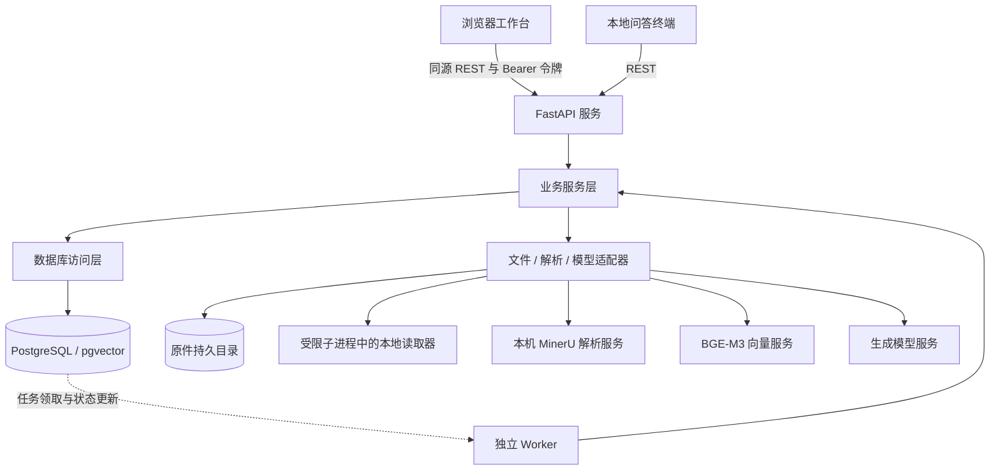
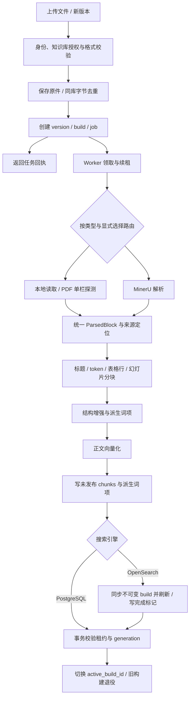
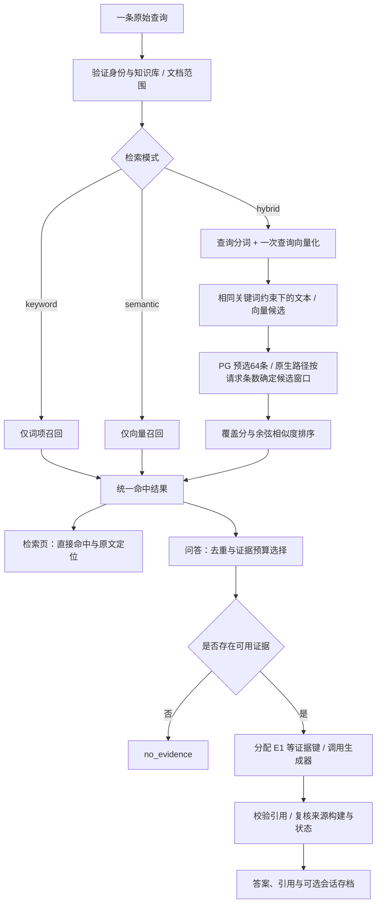
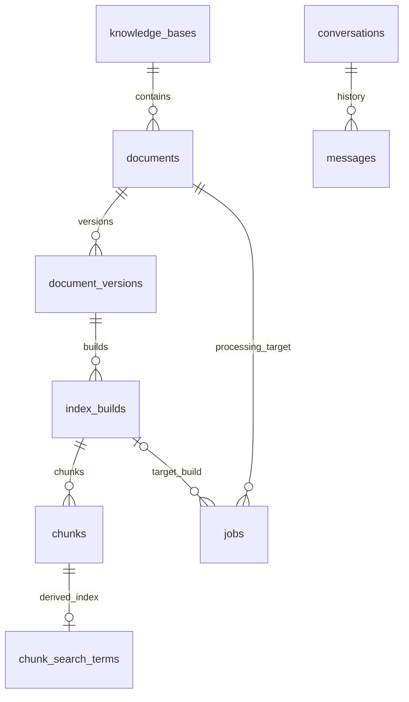

# 项目技术架构与实现规格

核对日期：2026-11-11。本文依据当前工作区实现整理，包含尚未提交的修改；描述当前运行链路，不将历史实验方案视为现行能力。

阅读顺序：整体组件与数据流见第 2–3 节，数据关系与生命周期见第 4–5 节，分块和检索算法见第 6 节，对外接口及安全边界见第 7–9 节，部署、配置与维护见第 11 节。

功能基线：14000c1。迁移操作见[运行手册](runbook.md)，取舍见[决策摘要](decisions.md)，未决项见[issues](../issues.md)。
本文不重新引入已回退的表格聚合、语义规划或分层通用回答。字段和DDL完整定义分别维护在OpenAPI、表定义与迁移中。

## 1. 定位与范围

主系统内的个人知识服务：建库、文档上传、异步处理、混合检索、证据问答、引用、版本更新/重建/删除。
工作台同源托管在/workbench/，提供文件、知识库、检索、问答与原件/提取正文浏览；不做Office保真编辑。
支持TXT/MD/CSV、文本PDF、DOCX、XLSX、PPTX；默认自动将扫描件、复杂PDF及图片路由到MinerU。
不做账号体系、共享授权、网页连接器、通用Agent平台、复杂表格自动理解或token流式输出。

## 2. 技术选型

优先复用成熟组件：FastAPI/Pydantic、PostgreSQL、pgvector、pg_trgm；任务与业务同库，独立Worker领取，不引入Celery。
原件放文件目录。当前向量索引固定1024维，同一物理索引不混写不同模型或维度，换模型须离线迁移和重标阈值。
基础解析复用pypdf、python-docx、openpyxl与标准库CSV/OOXML，不支持旧版XLS/PPT。

| 层次 | 当前组件 | 职责与边界 |
| --- | --- | --- |
| 浏览器工作台 | HTML、CSS、原生 JavaScript ES Modules | 知识库、文件、任务状态、手动检索、问答和引用阅读；由 API 同源托管，无独立前端构建服务 |
| HTTP 服务 | FastAPI、Pydantic、Uvicorn | 身份验证、参数校验、业务编排入口、响应与错误映射、静态文件 |
| 后台处理 | 独立 Python Worker、PostgreSQL 任务表 | 领取任务、解析、分块、增强、向量化、发布、失败重试及清理 |
| 业务及权威存储 | PostgreSQL、SQLAlchemy、psycopg、Alembic、pgvector | 业务事务、授权、版本与任务、正文、1024维向量及引用定位；兼容路径使用GIN及pgvector |
| 原生搜索索引 | OpenSearch、Lucene | 可重建词项与向量索引，多字段原生评分及过滤kNN；由配置显式选择 |
| 文件存储 | 本地持久文件目录 | 保存不可变原件；数据库保存服务端生成的对象键与校验值 |
| 文档解析 | 本地读取器、可选本机 MinerU 4.1 API | 简单格式本地解析，复杂 PDF 和图片交给 MinerU；具体路由见第 3.5 节 |
| 分词与结构增强 | RAGFlow 式算法适配、huqie、MARISA、WordNet、tiktoken | 归一化、主词与细粒度词、词位与短语、标题及可靠表头增强；资源在本地准备 |
| 模型服务 | OpenAI 兼容 HTTP 适配器 | 分别调用 `/embeddings` 与 `/chat/completions`，由配置决定服务地址 |

本机真实模式当前配置为 `BAAI/bge-m3`、1024 维和 `deepseek-chat`。这是部署配置，代码层的 `hash-1024` 与 `stub` 仅用于开发及隔离回归；默认真实模式启动失败时不会自动切换模型桩。

当前 `ragflow-v1` 是对 RAGFlow v0.24.0 分块、查询构造、候选召回与评分方法的 PostgreSQL 适配，不运行完整 RAGFlow 平台。当前默认分块为约 512 tokens、零重叠，取代此前的 800 字符方案。详细算法及移除项见第 6.1.2 节。

### 2.1 已移除的DeepDoc

2026-11-06按用户要求移除DeepDoc解析与Docker依赖，保留MinerU；历史DeepDoc构建只读保留，不再新增。
新上传/新版本只接受`legacy-v1`与`mineru-api4.1-v1`，接口与冻结语义见“显式可选解析器”。

## 3. 架构与代码

### 3.1 总体组件与部署关系

API 与 Worker 是独立进程，共用业务服务、数据库、原件目录和模型配置。上传请求只保存原件并创建任务，耗时处理由 Worker 执行；检索和问答由 API 同步响应。任务队列直接使用数据库，不另设消息中间件。模型服务与 MinerU 是独立依赖，代码通过适配器访问，不在业务进程中加载这些模型。

### 3.2 代码分层与模块职责

依赖组织为 `entrypoints → {api, mcp, worker} → services → domain ← repositories / adapters`。入口负责装配，API、MCP 与 Worker 并列；业务规则和编排在 services，领域表示与纯算法在 domain，数据库操作在 repositories，文件、解析与 HTTP 模型调用在 adapters。

| 目录或模块 | 主要内容 |
| --- | --- |
| `frontend/` | `app.mjs` 装配工作台；`core.mjs` 封装 API；`library/files/search/chat/reader` 等模块提供页面交互 |
| `backend/knowledge/entrypoints/` | API、Worker 入口及预留 MCP 入口 |
| `backend/knowledge/api/` | REST 路由、请求/响应模型、依赖注入与错误转换 |
| `backend/knowledge/worker/loop.py` | 任务领取、续租、执行、失败处理及恢复 |
| `backend/knowledge/services/` | `document` 上传与版本；`ingest` 索引构建；`retrieval` 统一检索与证据选择；`qa` 生成及引用校验；`cleanup` 删除清理 |
| `backend/knowledge/domain/` | 领域实体、端口、错误、分块算法、表格结构及查询评分特征 |
| `backend/knowledge/repositories/` | 业务表、授权 SQL、构建发布、任务状态、分块与 RAGFlow 式检索 SQL |
| `backend/knowledge/adapters/` | 本地/MinerU 解析、原件存储、预览、向量与生成 HTTP 客户端、分词及本地词典 |
| `backend/migrations/` | 数据结构与索引的 Alembic 增量迁移 |
| `backend/scripts/` | 启动、资源准备、派生词项回填、隔离回归与浏览器验收 |

MCP 已定义 `kb_list`、`doc_ingest`、`job_status`、`search`、`ask`、`chunk_get` 六个工具函数，但 stdio/SSE 协议入口尚未实现。当前可用入口是 REST、浏览器工作台和本地终端。

### 3.3 文档入库与发布数据流

分块正文、结构信息、原文定位、词项和向量在发布事务中一起生效。标题路径和可核验的表头用于增强关键词索引，向量化及问答证据仍取正文。新构建失败不替换旧发布内容，前端通过任务接口展示实际阶段与错误；任务租约、重试和删除的详细规则见第 5 节。

### 3.4 检索与问答数据流

搜索与问答共用 `services/retrieval.py` 和 `repositories/ragflow_search.py`，问答使用混合模式。关键词模式不调用向量模型；语义模式不依赖词项索引；混合模式词项为空时显式降级到语义并返回警告。混合召回的无候选补召回复用同一查询向量，不拆子问题、不调用查询扩展或外部重排模型。

问答默认最多从 20 个候选中按排名选择 6 条、总计不超过 6000 字符的证据。超预算片段会跳过，分块重复或同文档包含关系重复会去除，不自动拼接邻块。生成器仅收到本轮问题及证据正文；服务端将有效证据键映射成真实文档、版本、分块和来源位置。历史会话只作展示，不参与下一轮生成。算法、门槛及引用兼容边界详见第 6 节。

### 3.5 解析路由与格式适配

| 资料类型 | 未显式指定时的解析路径 | 分块与来源表示 |
| --- | --- | --- |
| TXT / Markdown | 本地文本读取；Markdown 识别正文、代码围栏及明确表格 | 标题或句界合并；代码独立；保留字符来源 |
| 简单单栏文本 PDF | 受限子进程检查整份文档，确认可安全提取后复用本地结果 | 标题或句界分块，保留原页与字符范围 |
| 扫描、混合、多栏、复杂或探测不确定 PDF | 整份交给本机 MinerU | 利用解析块、表格及版面结构，跨页块保留各段独立来源 |
| 图片 | 本机 MinerU OCR | 保留可用页/块/几何定位；精度不足显式降级 |
| DOCX | 本地段落与表格读取 | 正文按标题/句界，表格按行；引用使用段落或表号/行号 |
| CSV / XLSX | 本地记录或流式工作表读取 | 按数据行建块，保留工作表和真实行号；仅增强可靠表头 |
| PPTX | 本地读取幻灯片 OOXML | 每张幻灯片分块，保留幻灯片编号 |

PDF 探测最多 64 页、5 秒，无法确认简单单栏时使用 MinerU。正文采用 `cl100k_base` 计数，512 tokens 是普通合并的目标；标题分块有硬上限，表格行和幻灯片保留结构单元，不能将所有格式理解为固定字符切片。完整分块规则见第 6.1.2 节。

显式可选解析器：

上传及新版本multipart新增可选parser_profile：legacy-v1、mineru-api4.1-v1；
省略时由上传服务按实际类型路由：PDF冻结`pdf-auto-v1`，图片使用MinerU，其他支持格式本地解析；`pdf-auto-v1`是内部自动路由标识。
显式parser_profile优先；所有已支持文档均可选择两种方案；
基础解析本来不具备图片OCR，选用时仍明确报不支持，不伪造正文。TXT/MD在两种方案中均直接读取文本并明确标记，不声称经过OCR。
MinerU接本机4.1 file-parse API，除TXT/MD外均提交原件，固定tier=basic、ocr_mode=auto、page_range=all，
从默认ZIP内structured_content.json读取全量结果，不安装其SDK/模型到主环境，不使用云端。
只允许回环origin，无代理/重定向，生成无业务文件名的上传名；不跟随响应中的URL，202仅按本次request_id构造本机轮询/下载路径，限制总等待/响应/解压预算。
schema/页码/完整性校验失败报PARSE_FAILED，缺少精确几何或Office物理页码时降级block/page并告警；外部HTML仅转纯文本，不执行或抓取图片。
MinerU输出正文中的NUL等长替换为U+FFFD，块及build标记mineru_nul_replaced；原件不改，块内码点偏移不缩短。
此为数据库文本兼容修复，不自动重建历史内容；恢复失败文档仍经显式重建创建新build。
参数随新build冻结，重试/普通重建保留，不改数据库或旧文档；同字节去重回原回执，并返回已有build的parser_profile，界面提示选择未生效，不借重传换策略。
界面上传及新版本明确选择；默认与两端配置需一致，高级服务故障不回退基础解析。
文档详情的parser_profile优先显示已发布方案，尚未首次发布时显示待构建方案，避免失败文件隐藏原选择。
解析失败仍使用PARSE_FAILED；服务未启动、令牌缺失/不匹配、版本不匹配仅返回固定白名单操作提示，不透传上游异常。
MinerU结果ZIP读取上限为KS_MINERU_OUTPUT_BYTES，正文JSON仍受parse_output_bytes限制。
工作台只有显式选择历史会话才高亮该历史项；点击对话/文件等页面入口清除历史高亮，不删除会话内容。

命名、类型、日志与验证纪律唯一见根目录AGENTS，不在此重复。

## 4. 数据模型

八张业务表及一张派生词项表，UUID主键，时间UTC，JSON用JSONB。完整字段/索引/约束见backend/knowledge/repositories/tables.py及migrations。

| 表 | 核心语义 |
| --- | --- |
| knowledge_bases | owner来自Actor；状态active/deleting/deleted，archived表示保留数据但隐藏（不进列表，也不能作为检索或上传范围） |
| documents | current_version_id是已发布版本，active_build_id是当前构建，pending_build_id是待处理构建；generation为更新/删除栅栏 |
| document_versions | 不可变上传，保存version_no、object_key、sha256、media_type、byte_size；唯一(document_id,version_no)/(kb_id,sha256) |
| index_builds | 一次索引处理，冻结chunk_config及向量模型/维度；queued/running/ready/failed/cancelled/retired |
| chunks | build所属片段，保存ordinal、text、locator、warnings、embedding和关键词文本；唯一(build_id,ordinal)，向量HNSW/余弦和关键词GIN/trigram索引 |
| chunk_search_terms | 与chunk一对一的可重建派生索引；保存词项数组、分字段词项/词位、排序特征及lexical_revision，词项数组使用GIN索引 |
| jobs | ingest/reindex/cleanup；queued/running/succeeded/failed/cancelled；处理任务固定build_id/generation，cleanup不填 |
| conversations | owner所属的对话；状态active/archived，archived保留消息但不进历史列表 |
| messages | 本轮问题/答案、状态、引用与模型标识，仅作历史展示，不参与后续生成上下文 |

图中任务关系表示业务关联；`jobs.resource_id`是多用途资源标识，不是文档外键。文档通过当前版本和构建指针决定可见内容，不能简单把“最新上传”当成“当前发布”。向量直接保存在`chunks.embedding`，不使用独立向量数据库。历史trigram和英文FTS索引仍可存在于表结构中，当前关键词召回入口使用`chunk_search_terms`，不是历史BM25/OpenSearch或`fts-v1`链路。

locator页码1起，字符偏移为Unicode码点左闭右开；无法精确定位明确降级block/page。
DOCX用paragraph，不伪造分页；CSV/XLSX用sheet和真实1起行区间（两端包含），跳空行不压缩原坐标。
解析器的块内偏移不当作文档级偏移，跨页位置不裁成假的单页。警告按块保存，build保存并集。

### 不变量

1. 所有查询SQL内授权，无权、不存在、删除统一404，不先全库Top-K再过滤。
2. 仅active库、active文档、ready且等于active_build_id的内容可检索。
3. 发布在同事务校验有效lease_token、running、未过期租约、generation和pending_build_id。
4. 已发布内容不可改写；重试/重建产生新build，旧build退役不修改片段。
5. 引用仅指向本轮送模证据，excerpt由服务端从原文截取，模型不产生资源ID。
6. 删除提交即阻断访问；清理失败不恢复访问。持久库和临时库不共用原件卷。

## 5. 生命周期

上传：验证身份/格式/大小 → 服务端对象键写原件 → 单事务创建version/build/job并递增generation → 返回202回执。
同库同字节去重返回200；对象写入后事务失败的孤儿按超时规则回收，不在请求中误删其他库文件。

Worker在短事务用FOR UPDATE SKIP LOCKED领取任务，提交后解析/调用模型，独立线程续租。
默认租约120秒、心跳30秒、最多3次尝试，配置经Settings；启动及每轮领取前回收过期租约。
重试保留job ID、累计attempt和generation，新建同版本build并切换pending；旧代次取消，不接管新上传。
确定性格式/密码/空正文错误直接失败，可重试故障退避；心跳不复活过期租约。

发布按document → job → build加锁，单事务写片段、校验栅栏、切换发布指针、旧构建退役及任务成功。
失败不部分发布。首次发布前无可检索内容，更新期间旧发布继续服务。

删除事务置deleting、递增generation、清空指针、取消处理任务并建cleanup，立即不可检索/预览/读引用。
异步擦除原件、片段、构建和版本后置deleted，删除库先阻断整库。

## 6. 检索与问答

### 6.1 检索

query最多2000码点；knowledge_base_ids必填1–20个；top_k默认5、最多20；mode为hybrid/keyword/semantic。
两路 SQL 内均授权、限定当前发布构建。关键词与混合检索按下一节的词项和向量约束召回，纯语义检索按余弦相似度召回。
相关度分数用于排序，不能替代资料是否支持答案的判断。
向量配置不兼容报MODEL_UNAVAILABLE，不冒充no_evidence；显式keyword仍可独立使用。

### 6.1.2 RAGFlow 式 PostgreSQL 分块与检索

分块与检索统一使用 RAGFlow v0.24.0 算法适配，配置标识为 `ragflow-v1`。新上传和新文件版本使用新分块；历史分块、向量及引用保留。`KS_SEARCH_ENGINE` 显式选择 `postgresql` 或原生 `opensearch`，业务数据库始终为 PostgreSQL。旧分块、RRF、查询扩展、证据覆盖、邻接补全及HTTP重排已移除；新增的原生搜索路径区别于历史的单字段BM25适配。历史策略任务须在切换前排空，旧版本重建须上传新版本。

派生词项缺失不阻断工作台启动或文件管理。`GET /api/v1/search/status` 验证身份后仅统计当前用户可访问的当前发布分块及未结束旧策略任务，返回状态与计数，不访问模型。前端连接后、定期及手动重新检查时更新维护提示；检查失败也不阻断连接。相关范围的关键词检索和问答保持 `KEYWORD_INDEX_UNAVAILABLE`，不将缺索引伪装成无答案。存在旧策略任务时启动器只启动API，暂不启动Worker，待维护完成后重启。

- PDF 由受限进程探测整份版面，最多 64 页、5 秒。每页通过单栏检查，且纯文本与版面提取的字符顺序一致时，直接使用已提取的 pypdf 文本和定位。其余 PDF 整份交给 MinerU。图片默认用 MinerU，结构化文件默认本地解析。解析路由确定后在租约内持久化，自动重试复用。
- 按标题层级或句界组织正文，默认 512 tokens、零重叠。正文先按换行和句末标点划分，原始分隔符保留在来源范围内。普通文本参照上游 `naive_merge`，当前块超过目标后才开启下一块，同一来源的连续区间合为一个引用范围。标题分块参照上游 HierarchicalMerger，前言单独保留，子节带上祖先标题和引言，默认在第三层合并更深标题。跳级标题归最近的实际父标题。继承引言与子标题合计超预算时，尚未索引的祖先引言和当前引言单独保存一次。各分块用实际正文共有的章节路径建索引，深层小节另起块时保留其完整路径。标题分块保留硬上限，过长单段按源字符边界拆分，组合分块保留每段来源。表格按行，幻灯片按页，表格和图注只保留一次。标题、章节和经核对的表头进入派生索引。参照上游 `rag/app/table.py`，在表头与数据行逐列对齐时增加「列名: 值」词项。组合字段仅用于索引，向量及引用仍用分块正文。
- MinerU 的 HTML 表格按显式 `tr` 保留行范围，单元格内换行仍属于本行。参照上游合并表头算法，按 `rowspan`、`colspan` 还原明确的列路径，如「工况-温度」。只有本行真实出现且列归属明确的值会与列路径配对。表头、数据行和表内附文分别保留页号及解析块内码点范围，结构不可核验时保留原表格文本。
- XLSX 沿用只读流式正文解析。合并范围从对应工作表的 XML 部件单独读取，整本工作簿共享 16 MiB 扫描预算。仅当前两行有明确合并、前五行的表头与后续数据能区分、且列路径唯一时，才按工作表和真实行号增强列名与值。超预算仍可读取原行并标注合并结构不可用。合并数据单元格只保留源值，跨多列的值不配给单列。
- CSV 分块采用解析器返回的记录和单元格边界。引号内的换行与制表符保留在对应单元格，行尾空单元格仍计入列数。数据行与已识别表头列数一致时才补充表头和列值词项，列数不一致的记录仍保留原文和定位。
- DOCX 以每张表开头连续标记的表头和实际 Word 网格建立列路径。跨列合并或跨行继承的数据值仍保留在行正文，仅增强本行有明确单列归属的值。无法确认表头或网格时按行保存原文，引用保留表号及行号。
- `ragflow-v1` 的本地 Markdown 解析先识别顶层反引号或波浪号代码围栏，再解析其外的管道表格和正文。围栏、缩进和内部空行保留在原文范围，代码内的标题或表格样式仍是代码。短代码块独立索引，超预算时优先在原始行边界拆分。Markdown 表格以明确且等宽的表头与对齐行确认边界，转义管道保留在所属单元格，只有列数一致的正文行与同表表头配对。
- 标题、细粒度标题、可靠增强词项、正文和细粒度正文分别存储，采用上游对应字段权重的最佳字段分数。同义词优先使用固定提交的离线词典，英文词缺失时取本地 WordNet 3.0 的同义词集主词，作为降权备选并和主词共享匹配组。中文主词拆出多个细粒度词时，同一字段内的完整短语才计入该匹配组。相邻短语等同主词，容许两次词位移动的近邻短语按半权计分。中文和短查询的多词子句另计完整短语，单词权重先按子句归一化，完整短语权重为 1.5，再按最小词位偏移降权。GIN 先找词项，PostgreSQL 再用派生词位核验短语。整段短语限制为至多 128 个词位，覆盖分仍按查询词项和相邻词组单独计算。
- 文本查询按上游规则清洗问句用语，保留业务编号。中文和短查询的排序关键词序列先保留清洗后的子句，再按权重加入词项及细粒度词，并按上游规则限制同义词等扩展。整句有同义表达时，原子句分支权重为 5，每个完整同义表达的独立权重为 0.7。多词同义表达按同一字段内的完整词序核验。两路召回均受授权及当前构建约束。中文分支首轮按外层有效子句数的 30% 向下取整，同一子句中的多个词项或同义表达命中只计一次，至少要命中一个子句。较长英文查询只需至少一组匹配。向量路在相同文本集合按原始余弦相似度筛选。两路各保留 1024 条，融合预选时按 Elasticsearch 规则把向量路余弦映射为 `(1 + cosine) / 2`，再以 0.05/0.95 取前 64 条。缺席一路的候选在该路得 0 分。首轮无候选时复用原查询和子句，中文子句门槛降至 10%、向量门槛降至 0.17。
- 中文分支处理前 256 个子句。关键词累计达到 32 时停止生成单词召回条件，已经加入排序序列的词和后续原始子句仍参与最终覆盖计算。后续多词子句可凭完整近邻短语及其整句同义词召回。英文分支前 256 个词构造单词及同义词条件，全文相邻词对仍可凭完整词位召回。
- `ragflow-v1` 的新构建和查询向量须为有限数且非零。历史零向量的余弦相似度按 0 处理，仅可经关键词候选保留，避免无效余弦分进入向量候选和预选排序。
- 向量兼容性按检索范围检查当前发布构建。指定资料时只检查所选资料的模型和维度，并在召回 SQL 的同一快照再次核对。纯关键词模式独立于向量配置。
- 指定资料的纯语义检索先限定当前发布分块，再按 pgvector 余弦精确取前 K。未指定资料时沿用现有向量索引候选路径。
- 有有效词项时，关键词和混合召回在同一 SQL 快照检查授权范围内的当前发布分块。派生词项缺失、低于当前版本或缺少必需的词项、词位及排序数组时返回 `KEYWORD_INDEX_UNAVAILABLE`。启动预检与回填共用该就绪条件。索引齐全时的零命中返回空集，纯语义模式独立于词项索引。
- 最终得分为 0.7 × 词项覆盖 + 0.3 × 向量余弦，保留得分至少 0.20 的候选。词项覆盖使用上游 `term_weight.py` 的 IDF 公式，词频和词性来自 Infinity SDK 0.7.0.dev2 的 huqie 字典。长词缺少词频且能细分时，以各子词递归估算后的最低词频除以 6，并应用上游下限。固定版上游未附 `term.freq`，文档频率按其空表分支估算。复用同版分词算法，以 MARISA 词典前缀索引适配 Windows。全文与查询共用繁简归一化、中英文分词及英文词干规则，业务编号保留完整形式。参照 `token_similarity`，查询主词、细粒度词和同义词分别占权重，单词按 0.4 倍词权重累加，相邻词组按 0.6 倍两词最大权重累加。候选先对正文词按首次出现顺序去重，再拼接标题、章节及可信表头。按候选命中的查询权重除以查询总权重，得到词项覆盖分。关键词和语义模式独立执行，查询无有效词项时混合模式使用语义并标记降级。问答沿用证据预算及引用校验。

- 混合模式降级到纯语义时，`query_terms_empty` 是查询级警告。搜索结果为空或问答返回 `no_evidence` 时也保留该警告及对应的降级标志。
- 最终排序先保留正文、标题和表头的完整词序，再按上游规则去重正文。停用词仍不作为独立召回词项。历史派生索引由词项版本检查触发回填。

执行上先物化授权、当前发布版本及词项 GIN 条件筛出的集合，再核验词位与计算字段分数，避免相关评分子查询被规划到文档关联内部反复执行。各评分字段通过 `jsonb_to_record` 一次展开，字段及短语匹配结果保留求值边界。该执行优化不提前截断候选，不改变匹配门槛、字段权重和相关度公式，也不等同于 Elasticsearch 的原生倒排评分。

原生 OpenSearch 路径采用上游 Lucene `query_string` 表达式及最佳字段匹配。`*_tks` 用上游归一化IDF脚本相似度，`*_ltks` 用BM25，分词结果以whitespace建索引；标题10、细粒度标题5、重要关键词30、重要词20、问题词20、正文2及细粒度正文1。当前资料未生成问题增强字段，留空。两路均携带SQL给定的当前授权build集合，过滤kNN使用Lucene HNSW；首轮余弦门槛0.20，空集时以相同向量按0.17及更低文本匹配比例重试一次。上游ES文本boost实际为0.05、向量boost默认1.0。重排窗口为`max(30, ceil(64 / 请求条数) × 请求条数)`，例如Top20取80；仅对该窗口回源，按上游关键词序列及正文去重、标题两份、重要词五份组成的候选词序，计算单词0.4/相邻词组0.6覆盖分，再以0.7覆盖分+0.3原始余弦排序。关键词模式直接使用引擎词法分，不加向量最终门槛。语义模式保持单向量查询。

OpenSearch保存派生词项、候选词组特征及向量；API正文和引用始终从PostgreSQL当前发布构建读取，再次校验用户与版本。Worker先持久化未发布分块，释放事务锁后同步原生索引、刷新分块并写完成标记，最终发布再核验租约。缺标记或引擎故障明确报索引不可用，不回退成空结果；健康接口只报告当前用户受影响的分块。物理删除索引由清理任务完成，删除事务提交即阻断访问。原生索引映射有独立版本，版本不兼容时要求用新索引名回填，不原地改写旧索引。

参考 [RAGFlow v0.24.0 召回与排序](https://github.com/infiniflow/ragflow/blob/v0.24.0/rag/nlp/search.py) 和 [多字段查询](https://github.com/infiniflow/ragflow/blob/v0.24.0/rag/nlp/query.py)。

### 6.2 问答

检索 → 证据门槛 → 生成 → 引用校验 → 来源复核 → 返回/可选存档。
无命中或分数不足返回no_evidence，不调用生成。模型合法空sections也返回no_evidence。
格式为 `{"sections":[{"text":"...","evidence_keys":["E1"]}]}`，证据键由服务端分配。
未知键丢弃；全部非空段落无有效引用报CITATION_VALIDATION_FAILED，不返回正文；部分段落无键保留并显式告警，这是当前兼容行为，不代表已完成事实支持验证。
引用来源变化/删除报SOURCE_CHANGED；上游超时或故障与资料不足区分。
answered/no_evidence为主要状态，conflicting_evidence为保留状态，不代表已实现冲突判断。
conversation_id用于存档，本轮生成不读取历史答复；无通用回答兜底和表格聚合路径。

## 7. API

前缀/api/v1，Bearer令牌，snake_case JSON，时间ISO8601带时区；完整模型以运行实例/docs、/openapi.json为准。

| 方法与路径 | 用途/成功码 |
| --- | --- |
| POST/GET /knowledge-bases | 建库201/本人列表200 |
| DELETE /knowledge-bases/{id} | 阻断并异步清理202 |
| POST/GET /knowledge-bases/{id}/documents | 上传202（去重200）/列表200 |
| GET/DELETE /documents/{id} | 详情200/删除202 |
| POST /documents/{id}/versions | 新版本202 |
| POST /documents/{id}/reindex | 同模型重建202 |
| GET /documents/{id}/chunks、/chunks/{id} | 分块与定位200 |
| GET /documents/{id}/file | 原件字节200；位图可as=png转预览，多帧只首页，原件不变 |
| GET /documents/{id}/sheets、/documents/{id}/docx | 受限只读预览200，不代表完整解析结构 |
| GET /jobs/{id} | 阶段/尝试/错误200，无真实进度时不虚构百分比 |
| POST /search、/qa | 检索/问答200 |
| GET /search/status | 当前用户范围的派生词项与旧策略任务状态200，不调用模型 |
| POST/GET /conversations、GET/DELETE /conversations/{id} | 新会话201/列表200/历史200；删除200（消息级联，他人与不存在404，不用204） |

文件响应private/no-store/nosniff，Office原件attachment，不伪装HTML。引用预览仍需授权。
成功包装 `{data,meta:{request_id}}`；错误 `{error:{code,message,retryable},meta:{request_id}}`。

| HTTP | code |
| --- | --- |
| 401/404 | UNAUTHENTICATED / RESOURCE_NOT_FOUND |
| 409 | VERSION_CONFLICT / SOURCE_CHANGED / STALE_JOB |
| 413/415/422 | FILE_TOO_LARGE / UNSUPPORTED_FORMAT / VALIDATION_ERROR |
| 502/503/504 | CITATION_VALIDATION_FAILED / MODEL_UNAVAILABLE / MODEL_TIMEOUT |

### 7.1 重建与人工恢复

请求仅 `{"version_id":"UUID","expected_generation":1}`，两项必填，代次为严格非负整数，不接受模型/路径/owner等额外字段。
只重建最新上传版本，包括失败版本；无权/删除/版本不归属文档统一404。
代次过期、非最新、已有queued/running处理任务或向量配置不一致返回409，不取消原任务。
同事务新建build/job并递增generation，回执含document_id/version_id/build_id/job_id/generation。
原件和上传版本不变，沿用冻结配置，成功前旧发布可读，失败不撤销旧内容。
重复旧请求409，调用方刷新详情/任务；不支持历史回滚、在线换向量或策略升级。

## 8. 安全

本地使用HMAC签名subject_id/tenant_id/exp令牌，属于开发桩，主系统接入必须替换验证器。
身份不接受请求体自述；对象键服务端生成，文件名不拼接存储路径。
解析在可终止子进程执行，限制耗时/CPU/RSS、解压条目/总量及输出；采样限制不等于OS硬沙箱。
模型输入是资料而非指令，无文件/SQL/工具权限；端点与外发范围由配置和授权控制。
错误白名单输出，日志不记问题、答案、片段、原件、内部响应或密钥。真实接入前补审计、保留期和配额。

## 9. QwenPaw边界

不fork/接入宿主主仓，MCP与REST共用services；当前仅有工具函数，协议与Skill包未完成。
subject_id只由可信Skill配置注入，不从对话/参数推断；ReMe记忆不能当引用证据，接入形态待确认。

## 10. 验收

M01上传到检索、M02引用定位、M03无证据不生成、M04跨用户隔离、M05版本原子切换、
M06崩溃恢复不重复、M07删除不复活、M08同字节去重及版本区分，都应有自动回归。
完整检查不得以跳过/xfail/排除用例算通过；工程与真实模型效果分开，待办与效果只在issues维护。

## 11. 运行配置、维护与验证边界

### 11.1 Windows 本地运行

根目录`start.cmd`调用PowerShell启动流程，准备Python依赖、模型配置、本地词典、数据库及按需使用的MinerU，再启动API和Worker。工作台位于`/workbench/`，接口文档位于`/docs`，API前缀为`/api/v1`。端口和模型地址由启动参数、环境变量及`backend/.env`确定，不在架构文档中固定业务服务地址。

真实模式复用持久数据库及原件卷。未显式指定数据库时，启动器可管理本机带pgvector的PostgreSQL；原件默认保存在`backend/.data/objects`。Demo模式使用独立临时库、临时目录和模型桩。数据库记录与原件文件必须成对备份、恢复和迁移。

API与Worker必须使用相同数据库、原件目录、词项资源、模型标识和向量维度。模型客户端分批处理正文向量，当前配置类默认每批16条；查询只编码一次。模型超时和不可用有独立错误，不伪装为资料无答案。当前处理是按文档构建并原子发布，不支持一份文档边向量化边部分发布。

### 11.2 索引维护与故障可见性

数据库结构通过Alembic迁移，当前代码迁移链末端为`0010_ragflow_lexical_rev`。词项算法版本另由`LEXICAL_REVISION`管理，当前为7；结构迁移成功不等于历史派生词项已经回填。`backfill_ragflow_terms.py`依据已发布正文重建派生索引，不更换原向量和原文引用。

缺少或过期的派生词项不会阻断工作台启动与文件管理。前端通过`GET /api/v1/search/status`在连接后、定期和手动检查时展示维护提示；相关范围内的关键词与混合检索返回`KEYWORD_INDEX_UNAVAILABLE`，语义检索独立运行。发现未结束旧策略任务时，启动器暂不启动Worker，防止用停用策略继续处理。词典缺失、模型配置错误等运行依赖故障仍须修复，不能一概视为可忽略维护提示。

任务使用数据库租约、心跳与generation控制并发，默认最多尝试3次。可重试故障创建新build，不原地改已发布片段；确定性解析错误直接失败。原件持久保存与索引发布是不同状态，前端能显示处理失败的文件并提供恢复入口。具体安装、回填与恢复步骤统一见[运行手册](runbook.md)。

### 11.3 工程与效果验证

验证分为静态/类型检查、单元测试、真实PostgreSQL隔离集成、HTTP和浏览器回归，以及真实模型检索实验。后端集中入口为`backend/scripts/check.py`，前端单测入口为`node --test frontend/core.test.mjs`，浏览器场景由`backend/scripts/browser_smoke.py`执行。

协议夹具与模型桩用于验证生命周期、权限、版本和引用契约；检索准确率、无答案误匹配及含查询向量化的延迟必须来自真实模型实验。当前效果、样本规模、失败与未完成项统一维护在[issues](../issues.md)，本文不将历史实验值写为当前系统承诺。尚未实现的能力包括MCP协议接入、正式账号体系、跨用户共享授权、会话历史参与推理、复杂表格聚合及token流式输出。

## 附录 A 术语

| 术语 | 定义 |
| --- | --- |
| document/version/build | 资料身份/不可变上传/一次索引构建，重建只新增build |
| current_version/active_build | 当前发布版本/构建，不一定是最新上传 |
| generation/lease_token | 文档更新栅栏/单次领取凭证，不能互相替代 |
| chunk/locator/excerpt | 片段/原始定位/服务端原文摘录 |
| evidence_key/citation | 本轮服务端证据键/绑定真实资源与定位的引用；有效引用不等于事实必被支持 |
| parser_profile | build冻结的解析策略，历史缺省legacy-v1，不是模型权重指纹 |
